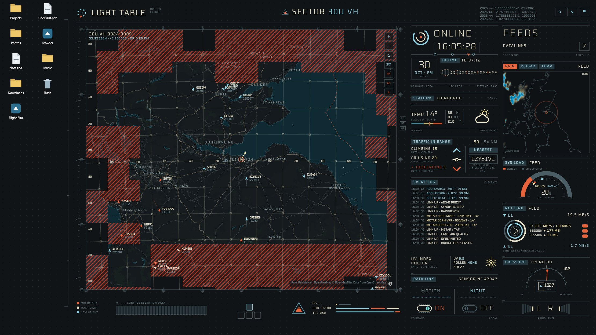
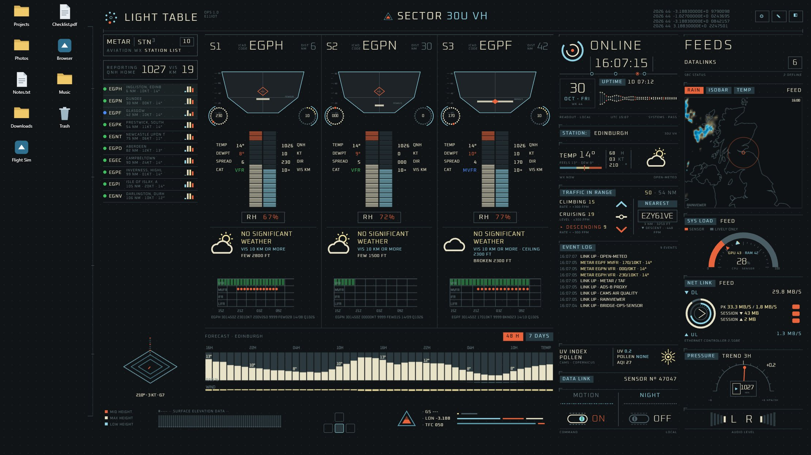
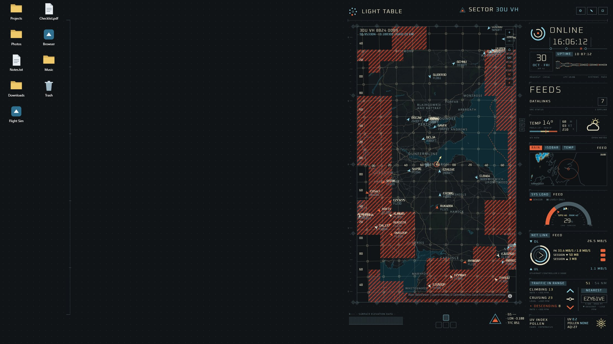
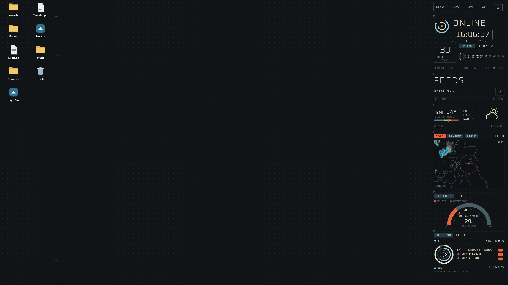
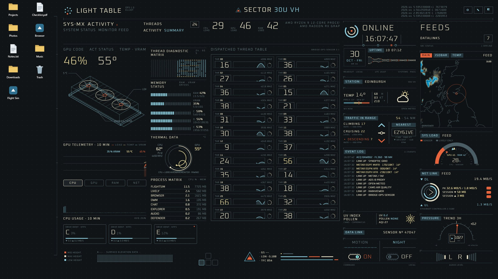

# Light Table Ops

**An animated glass light-table console as a live desktop wallpaper for [Lively Wallpaper](https://github.com/rocksdanister/lively) (Windows).**
Map with flight radar, rain radar and weather warnings, aviation weather (METAR/TAF), forecast and per-thread system monitoring – all live, all clickable.

> Non-commercial **fan / community project**, inspired by the screen graphics of the film *Oblivion* (2013) by [GMUNK](https://gmunk.com/). Not affiliated with or endorsed by the film studio or the designer – every graphic was redrawn from scratch in code. See [Credits & legal](#credits--legal).

Screenshots: browser demo with live data for Edinburgh (weather, METAR, rain radar, ADS-B), simulated system sensor values and placeholder desktop icons.

---

## What it does

| | |
|---|---|
| **Map** | Dark vector map or satellite imagery, real UTMREF/MGRS grid, live aircraft (ADS-B) with click-for-details (route, type, registration, altitude profile), rain radar, DWD weather warnings as a large dot-matrix alert. Zoom, pan, re-center. |
| **Weather / METAR** | The 3 nearest reporting stations: cloud layers as a "funnel" with height scale, temperature/dew-point column, wind rings, decoded weather, flight category, TAF timeline (VFR/MVFR/IFR/LIFR). 48 h and 7-day forecast. |
| **System** | CPU load per thread with clock, GPU wireframe with load/temperature/VRAM history, RAM/VRAM/drive usage, top processes, drive activity, thermal data. |
| **Flights** | Traffic list sorted by distance: climbing / cruising / descending, select to highlight on the map. |
| **Side feeds** | Clock & uptime, current weather, traffic summary, network throughput, pressure trend, UV/pollen, mini synoptic map (rain / isobars / temperature), data-link status, event log, audio level. |
| **Details** | Click any panel – a detail drawer slides in and the layout shifts. |

### Three layouts – around your desktop icons

| Full | Half | Strip |
|---|---|---|
|  |  |  |

* **Full** – the whole free area next to your icons.
* **Half** – half of the free area.
* **Strip** – a narrow column (right, left or bottom). The strip never changes size; opening a view or a detail adds a panel next to it.
* Icon zone (columns, cell size, side) and console edges are adjustable in Lively or by dragging the handles in the wallpaper (✎).
* Each monitor keeps its own layout (e.g. 4K + 1440p).

---

## Install

1. Download **`Light-Table-Ops-Lively.zip`** from [Releases](../../releases) (or zip the `Light-Table-Ops` folder).
2. Drag the zip into the Lively window and assign it to your screen(s).
3. On first start the setup asks for your location (⚙ opens it again).
4. For clicks: Lively → Settings → Wallpaper → *Wallpaper input* → **Mouse**.

Works without any account or API key. Weather, METAR/TAF, rain radar and warnings are fetched directly.

### Optional: flight radar (ADS-B proxy)

The free ADS-B services can't be queried directly from a wallpaper. Upload [`adsb.php`](Light-Table-Ops/adsb.php) to any PHP web space you own, then enter its URL in ⚙ setup. Guide: [`PROXY-HOSTING.txt`](Light-Table-Ops/PROXY-HOSTING.txt). Please run it for yourself only – the data sources are non-commercial.

### Optional: Bridge-Ops-Sensor (Windows)

A small, readable PowerShell helper (folder [`Bridge-Ops-Sensor`](Bridge-Ops-Sensor)) that adds values Lively doesn't provide: load and clock per thread, top processes, drives, VRAM, GPU temperature, uptime. It only listens on `127.0.0.1` and answers only the wallpaper.

* **Standard mode** – no admin rights.
* **Extended mode** – adds CPU temperature, power and core clocks via [LibreHardwareMonitor](https://github.com/LibreHardwareMonitor/LibreHardwareMonitor) (downloaded during install, MPL-2.0) and the PawnIO driver (e.g. installed with Fan Control). Runs as a Windows task with admin rights; one UAC prompt during install.

Without the sensor the wallpaper still works; thread tiles are then marked as simulated.

### Browser demo

**[▶ Open the live demo](https://e11i0t09.github.io/Light-Table-Ops/demo/)** – runs in any desktop browser: live data for Edinburgh, simulated sensor values and placeholder icons.

| Layout | Map | System | Weather | Flights |
|---|---|---|---|---|
| Full | [▶](https://e11i0t09.github.io/Light-Table-Ops/demo/?mode=full&view=map) | [▶](https://e11i0t09.github.io/Light-Table-Ops/demo/?mode=full&view=sys) | [▶](https://e11i0t09.github.io/Light-Table-Ops/demo/?mode=full&view=wx) | [▶](https://e11i0t09.github.io/Light-Table-Ops/demo/?mode=full&view=flt) |
| Half | [▶](https://e11i0t09.github.io/Light-Table-Ops/demo/?mode=half&view=map) | [▶](https://e11i0t09.github.io/Light-Table-Ops/demo/?mode=half&view=sys) | [▶](https://e11i0t09.github.io/Light-Table-Ops/demo/?mode=half&view=wx) | [▶](https://e11i0t09.github.io/Light-Table-Ops/demo/?mode=half&view=flt) |
| Strip | [▶](https://e11i0t09.github.io/Light-Table-Ops/demo/?mode=strip) | | | |

Flight radar in the demo: append `&proxy=<your adsb.php URL>`. Source in [`demo/`](demo).

---

## Settings (Lively → Customise)

Layout · strip side/width · icon zone · main view · map style · place · ADS-B proxy · range · units (aviation / metric) · interface size · brightness · night dimming (auto/on/off) · animation intensity · frame-rate limit · boot sequence · sensor port · setup wizard · edit layout.

---

## Credits & legal

**Inspiration** – the on-screen UI of the film *Oblivion* (2013, Universal Pictures, directed by Joseph Kosinski), designed by **GMUNK (Bradley G. Munkowitz)** – <https://gmunk.com/>.
This is a non-commercial fan / community project. It contains no original artwork, film frames, logos, photos, fonts or text from the film; all graphics are independent re-drawings in code. Not affiliated with, endorsed or approved by Universal Pictures, GMUNK or any other rights holder. Names are used only to credit the inspiration; trademarks and copyrights belong to their owners.

**Data** – Open-Meteo (CC BY 4.0) · CAMS / Copernicus via Open-Meteo · MET Norway (NLOD / CC BY 4.0), fallback aviationweather.gov · RainViewer · Deutscher Wetterdienst (DWD) · airplanes.live / adsb.lol (ODbL) and hexdb.io via your own proxy · OurAirports (public domain) · Natural Earth (public domain).
**Maps** – OpenFreeMap, © OpenMapTiles, © OpenStreetMap contributors (ODbL) · optional imagery © Esri, Maxar, Earthstar Geographics (private use).
**Software & fonts** – MapLibre GL JS (BSD-3-Clause) · Oxanium by Severin Meyer (SIL OFL 1.1) · LibreHardwareMonitor (MPL-2.0, downloaded only in the sensor's extended mode).

**No warranty.** Weather warnings: only official warnings count. METAR/TAF and flight radar are **not** for flight planning or navigation.

**License** – © 2026 E11iot – [CC BY-NC-ND 4.0](LICENSE.md): use and share unchanged, with attribution, non-commercial, no published derivatives. Third-party data, maps, software and fonts keep their own licenses – details in [LEGAL.md](LEGAL.md).
